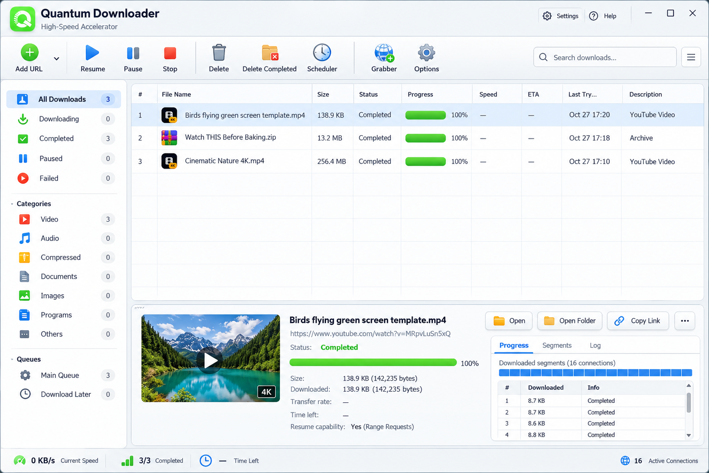

# ⚡ Quantum Downloader

A fast, multi-segment download manager and video sniffer for desktop, built with Electron and Vite.

**Made by [Subham Dey](https://github.com/OXeroSevyn)**

  

[](https://github.com/OXeroSevyn/quantum-downloader/releases/latest) [](https://github.com/OXeroSevyn/quantum-downloader/releases/latest)

---

## 📸 Screenshots & Demo

| Feature | Screenshot |
|---------|------------|
| Main UI |  |
| Video Sniffer |  |

**Live demo:**


---

## 📖 Overview

**Quantum Downloader** is a download manager and universal video sniffer. It splits files into multiple concurrent segments, reallocates threads dynamically, and integrates with major browsers (Chrome, Edge, Brave, Firefox, Opera, Vivaldi) through a companion extension.

---

## 🚀 Key Features

- **Multi-Thread Segmentation**
  - Splits files into **8–32 concurrent HTTP Range** connections.
  - **Dynamic Chunk Stealing**: faster threads automatically take over lagging chunks.
  - Direct-offset writes to disk for high throughput.
- **Video Stream Sniffer**
  - Detects videos on web pages (MP4, WebM, HLS `.m3u8`).
  - Downloads, stitches, and saves video segments automatically.
- **Real-time Metrics**
  - Live speed graph (canvas-based throughput visualizer).
  - Interactive multi-segment thread visualizer.
  - Automatic clipboard link detection.
- **Cross-Browser Extension**
  - Works with Chrome, Edge, Brave, Opera, Vivaldi, and Firefox.
  - Optional native-messaging registration for Windows.

---

## 💻 Platform Support

| Platform | Status |
|----------|--------|
| Windows | ✅ Prebuilt installer and portable build |
| macOS | 🛠️ Build from source |
| Linux | 🛠️ Build from source |

---

## 📦 Installation (Windows)

1. Go to the [Releases page](https://github.com/OXeroSevyn/quantum-downloader/releases/latest).
2. Download one of the following:
   - **Installer**: `Quantum Downloader Setup 1.0.0.exe` (adds a desktop shortcut and Start Menu entry).
   - **Portable**: `Quantum Downloader 1.0.0.exe` (no installation, just double-click to run).
3. Run it.

> **Windows SmartScreen:** The installer is not code-signed yet, so SmartScreen may show a warning. Only download from the official Releases page. If the warning appears, click **More info → Run anyway**.

**Checksums (SHA-256):**

```text
Quantum Downloader Setup 1.0.0.exe : <paste checksum here>
Quantum Downloader 1.0.0.exe       : <paste checksum here>
```

---

## 🌐 Browser Extension Setup

The extension source lives in:

```
<project_root>/extension
```

### Chrome / Brave / Edge / Opera / Vivaldi
1. Open `chrome://extensions` (or the equivalent for your browser).
2. Enable **Developer mode**.
3. Click **Load unpacked** and select the `extension` folder.

### Firefox
1. Navigate to `about:debugging#/runtime/this-firefox`.
2. Click **Load Temporary Add‑on...**
3. Choose `extension/manifest.json`.

### Optional: Native Messaging Registration (Windows)
Run the provided batch file:

```
extension\install_registry.bat
```

This registers the native messaging host keys required for the extension to communicate with the Electron backend.

---

## 🛠️ Development & Build

### Prerequisites
- **Node.js** (>= 20)
- **npm** (comes with Node)
- **PowerShell** (Windows) or a Unix‑compatible shell (macOS/Linux)

### Install Dependencies
```bash
npm install
```

### Run Locally (Development Mode)
```bash
npm run dev    # Starts the Vite dev server for the UI
npm start      # Launches Electron with the dev‑built UI
```

### Build
```bash
# Build the renderer (React/Vite UI)
npm run build:renderer

# Compile the Electron main process (TypeScript)
npm run build:electron

# Optional: Build a macOS DMG (requires a macOS machine)
npm run build:mac
```

Windows build output goes to the `dist-package` folder:

| Artifact | Path |
|----------|------|
| Installer | `dist-package\Quantum Downloader Setup 1.0.0.exe` |
| Portable | `dist-package\Quantum Downloader 1.0.0.exe` |
| Unpacked app | `dist-package\win-unpacked\Quantum Downloader.exe` |

---

## ⚖️ Legal Disclaimer

Quantum Downloader is intended for downloading content you own or have permission to download. Do not use it to bypass DRM, violate a website's terms of service, or infringe copyright. You are solely responsible for how you use this software.

This software is provided "as is", without warranty of any kind. The authors are not liable for any damage or claim arising from its use.

---

## 🤝 Contributing

Contributions are welcome!

1. Fork the repository and create a feature branch.
2. Follow the existing TypeScript/React code style.
3. Make sure `npm run build:renderer` and `npm run build:electron` both succeed.
4. Update the documentation if your change affects it.
5. Open a pull request describing what you changed and why.

---

## 📜 License

Copyright (c) 2026 **Subham Dey** ([@OXeroSevyn](https://github.com/OXeroSevyn))

Licensed under the **MIT License**. See the `LICENSE` file for details. The copyright notice above must be kept in all copies or substantial portions of the software.

---

## 🙏 Acknowledgments

- **ffmpeg-static**: cross-platform media utilities.
- **Lucide React**: icon set used throughout the UI.
- **ws**: WebSocket library for real-time communication.
- **Electron**: core framework powering the desktop app.

---

*Made with ❤️ by **Subham Dey** · [GitHub](https://github.com/OXeroSevyn) · [Blend Mode Studio](https://instagram.com/blendmodestudioofficial) · 2026*